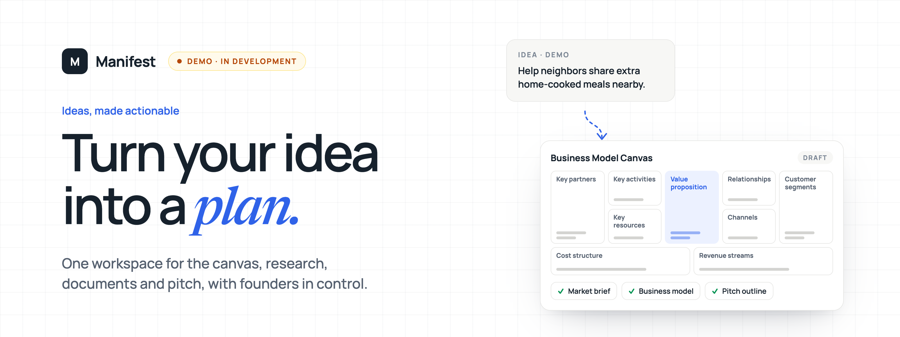
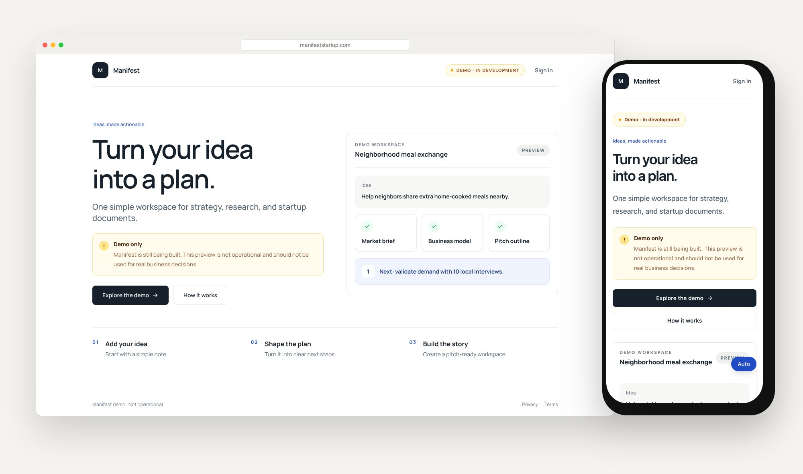

  <a href="https://www.manifeststartup.com">
    <picture>
      <source media="(prefers-color-scheme: dark)" srcset="assets/banner-dark.png">
      
    </picture>
  </a>

  <strong>From a rough idea to an investable plan, in one workspace.</strong> 
  We build tools that help founders validate, develop and pitch ideas, and open-source software that keeps people in control of their data.

  <a href="https://www.manifeststartup.com"><strong>Website</strong></a> ·
  <a href="https://openmedia.site"><strong>Open Media</strong></a> ·
  <a href="https://manifest-startup.github.io/OpenMarketIQ/"><strong>OpenMarketIQ</strong></a> ·
  <a href="mailto:hello@manifeststartup.com"><strong>Contact</strong></a>

  
  
  

### Manifest

**An IDE for startups.** Write your idea as a note. Manifest turns it into a Business Model Canvas, research and startup documents, and keeps them in step as the idea changes. Teammates and investors can join the same workspace, and you decide what gets published.

  <a href="https://www.manifeststartup.com">
    <picture>
      <source media="(prefers-color-scheme: dark)" srcset="assets/hero-dark.jpg">
      
    </picture>
  </a>

<table>
  <tr>
    <td width="33%" valign="top">
      <h4>01 · Idea in, plan out</h4>
      A short note becomes a canvas, related ideas to learn from, and drafts of pitch decks and other startup documents.
    </td>
    <td width="33%" valign="top">
      <h4>02 · Everything stays linked</h4>
      Edit the idea and the work built from it follows, in one workspace you can share.
    </td>
    <td width="33%" valign="top">
      <h4>03 · Founders stay in control</h4>
      AI drafts, you decide. Ideas stay private until you publish them.
    </td>
  </tr>
</table>

Manifest is a demo in active development. Its source is private.

### Open source

| | Project | What it is |
| --- | --- | --- |
| 🌐 | [**open-media**](https://github.com/Manifest-Startup/open-media) · [openmedia.site](https://openmedia.site) | One app for your social world: one feed across Open Media, Farcaster, Lens, Hive and DeSo, one inbox, and one post to every network. Agent-ready with a public API, MCP servers, WebMCP and a Claude Code and Codex plugin. TypeScript, React Native. MIT. |
| 📈 | [**OpenMarketIQ**](https://github.com/Manifest-Startup/OpenMarketIQ) · [docs](https://manifest-startup.github.io/OpenMarketIQ/) | Real-time market prices for anything (API pricing, tech tools, services, consumer goods), each with a source citation. Python client and React frontend. MIT. |

### Get in touch

Questions, partnerships or feedback: [hello@manifeststartup.com](mailto:hello@manifeststartup.com).

   
  <strong>Manifest</strong> · Capture the spark. Develop the case. Operate with confidence.

